<div align="center">



**A bot that opens today's Wordle, reads the tile colours and solves it for you.**


</div>

---

## How it works

1. Downloads a list of valid five-letter words.
2. Opens the New York Times Wordle in a real Chromium window with [Playwright](https://playwright.dev/python/).
3. Opens with **CRANE**, then types each guess with real keystrokes.
4. Reads every tile's state (`correct`, `present` or `absent`) straight from the page.
5. Filters the word list against that feedback, handling repeated letters, and guesses again from what's left.
6. If the game rejects a word as "not in word list", it clears the row and tries another.
7. Stops when all five tiles are green, then keeps the browser open for 10 seconds so you can screenshot the result.

| Tile | State read by the bot | Colour |
|---|---|---|
| ✅ | `correct` | Green |
| 🟨 | `present` | Yellow |
| ⬜ | `absent` | Grey |

---

## Quick start

```bash
git clone https://github.com/aryankhanna1409/auto_wordle.git
cd auto_wordle

pip install playwright
playwright install chromium

python wordle_bot.py
```

The browser opens on the Wordle page. **Close the "How to Play" and "Log in" pop-ups yourself**, click the empty board once so it has keyboard focus, then press **Enter** in the terminal to start the bot.

---

## Files

| File | Purpose |
|---|---|
| `wordle_bot.py` | The whole bot: word list download, feedback filter and browser loop |

---

<div align="center">


A small automation experiment · built for fun

<sub>Part of <a href="https://github.com/aryankhanna1409">Aryan Khanna's portfolio</a>: one loop, five pours, from robots to AI systems.</sub>

</div>
